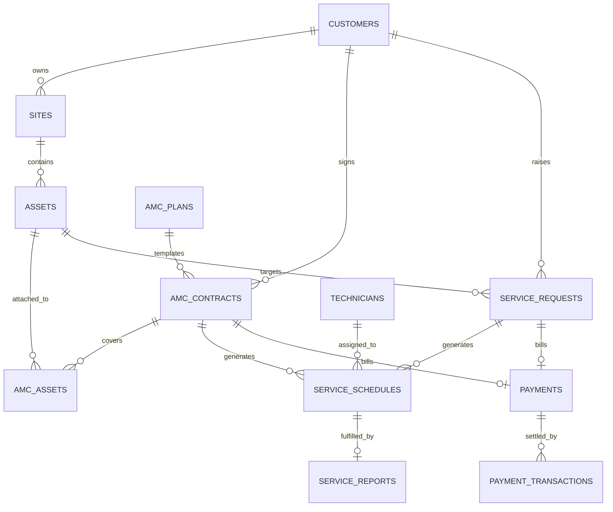

# Website Integration Audit Report
**Target Platform**: Place Your Service (Extreme Sales & Services — PYS)  
**System Type**: Commercial HVAC & Air Conditioning Field Service Management (FSM) & AMC Enterprise System  
**Audit Scope**: Full Website & Backend API Integration Assessment for Connecting with External Websites, Customer Portals, or ERPs  
**Date**: November 11, 2026  
**Status**: Production Live (`origin/main`)

---

## 1. Executive Integration Summary

Place Your Service (PYS) is architected as a **decoupled, API-first client-server web application**. It possesses high architectural readiness for integration with external systems, customer-facing websites, payment gateways, and enterprise accounting software.

### Architecture Topology
```
┌─────────────────────────────────┐         ┌─────────────────────────────────┐
│     EXTERNAL WEBSITE / ERP      │         │   PLACE YOUR SERVICE (FRONTEND) │
│  (Customer Portal / E-commerce) │         │     Vercel React + Vite SPA     │
└───────────────┬─────────────────┘         └────────────────┬────────────────┘
                │                                            │
                │ REST API Calls                             │ REST API Calls
                │ (JSON / HTTPS)                             │ (JSON / HTTPS)
                ▼                                            ▼
┌─────────────────────────────────────────────────────────────────────────────┐
│                    RENDER NODE.JS / EXPRESS REST API ENGINE                 │
│                 https://place-your-service-api.onrender.com                 │
│                                                                             │
│  • 18 Modular Sub-Routers (/api/v1/...)   • Zod Schema Request Validation   │
│  • Supabase JWT & PIN Auth Verification   • Global Rate Limiter & Audit Log │
└──────────────────────────────────────┬──────────────────────────────────────┘
                                       │
                                       │ Pooled DB Connection / PostgREST
                                       ▼
┌─────────────────────────────────────────────────────────────────────────────┐
│                       SUPABASE POSTGRESQL CLUSTER                           │
│                 https://jvccvdxfilzlncbgiplk.supabase.co                    │
│                                                                             │
│  • 20+ Normalized Relational Tables       • Row-Level Security (RLS)        │
│  • Foreign Keys & Cascade Protections     • Automated Audit Triggers        │
└─────────────────────────────────────────────────────────────────────────────┘
```

### Readiness Scorecard
| Dimension | Rating | Analysis |
| :--- | :---: | :--- |
| **REST API Coverage** | **9.5 / 10** | 18 versioned sub-routers covering all operations: Customers, Equipment, Requests, Scheduling, Reports, AMC, Payments, Inventory. |
| **Data Normalization** | **10 / 10** | Clean foreign-key constraints linking Customers → Sites → Assets → Contracts → Schedules → Reports → Payments. |
| **Authentication & RBAC** | **8.5 / 10** | Dual auth architecture: Supabase JWT for Staff/Admin, and mobile Phone/PIN token auth for field technicians. |
| **B2B Tax & Compliance** | **9.5 / 10** | Indian GSTIN validation, offline state/entity decoder, 18% & 28% statutory GST compliance, SAC 998719. |
| **Embedding / Iframing** | **6.0 / 10** | Currently protected by `helmet.frameguard: { action: 'deny' }`. Needs domain whitelist for direct `<iframe>` embedding. |
| **Webhooks / Events** | **6.5 / 10** | Internal `activity_logs` audit trail exists, but outbound webhook dispatchers to external URLs are not yet wired. |

---

## 2. Integration Patterns (How Another Website Can Connect)

An external website or system can integrate with Place Your Service via four primary patterns:

### Pattern A: Headless Server-to-Server REST API (Recommended)
Your external backend communicates directly with the PYS Express API over HTTPS.
* **Base URL**: `https://place-your-service-api.onrender.com/api/v1`
* **Transport**: HTTPS, JSON request/response bodies.
* **Authentication**: Service-Role JWT or Admin Bearer Token passed via `Authorization: Bearer <token>`.
* **CORS**: Completely bypasses browser CORS restrictions because server-to-server requests have no `Origin` header (handled automatically by `server/src/app.ts`: `if (!origin) return callback(null, true);`).

### Pattern B: Client-Side Cross-Origin AJAX / Fetch Integration
If an external website's browser code calls PYS APIs directly:
* **Requirement**: The external website domain (e.g. `https://my-storefront.com`) must be appended to the backend's `CORS_ORIGIN` environment variable.
* **Headers**: Client must supply `Content-Type: application/json` and `Authorization: Bearer <token>`.

### Pattern C: Embedded UI / Iframe Widgets
If the other website wants to embed PYS components (e.g., Public AC Service Request Form, AMC Rate Calculator, or Technician Portal):
* **Security Modification Required**: PYS currently uses Helmet with `frameguard: { action: 'deny' }`.
* **Fix for Integration**: Configure Helmet to use `frameguard: false` and set Content Security Policy (CSP):
  ```typescript
  frameAncestors: ["'self'", "https://your-parent-website.com"]
  ```

### Pattern D: Direct Database Read-Replica / Foreign Data Wrapper
If high-throughput business intelligence, reporting, or ETL pipelines are required:
* Connect directly to the Supabase PostgreSQL cluster using read-only database credentials or Supabase PostgREST API keys.

---

## 3. Comprehensive REST API Inventory

All API endpoints are versioned under the `/api/v1/` prefix.

### 1. System Health & Diagnostics
| Method | Endpoint | Auth | Description |
| :--- | :--- | :---: | :--- |
| `GET` | `/api/v1/health` | Public | Lightweight liveness check (`{ status: "healthy", uptimeSeconds }`). Rate-limit exempt. |
| `GET` | `/api/v1/health/ready` | Public | Deep database readiness check. Verifies Supabase connection latency. |

### 2. Authentication & Staff Operations
| Method | Endpoint | Auth | Description |
| :--- | :--- | :---: | :--- |
| `GET` | `/api/v1/auth/me` | Bearer | Returns the authenticated staff profile, email, and role (`ADMIN` / `STAFF`). |
| `POST` | `/api/v1/auth/logout` | Bearer | Invalidates active user session and logs audit activity. |
| `GET` | `/api/v1/staff` | Admin | Lists active staff members with pagination and role filters. |
| `POST` | `/api/v1/staff` | Admin | Creates a new staff member profile. |

### 3. Customer & Compliance Register
| Method | Endpoint | Auth | Description |
| :--- | :--- | :---: | :--- |
| `GET` | `/api/v1/customers` | Staff | Lists customers with query filters (`search`, `type`, `page`, `pageSize`). |
| `GET` | `/api/v1/customers/:id` | Staff | Returns full customer record including primary site, GSTIN, and active contracts. |
| `POST` | `/api/v1/customers` | Staff | Creates customer with company name, phone, email, and 15-char GSTIN. |
| `PATCH` | `/api/v1/customers/:id` | Staff | Updates customer contact, address, or GSTIN particulars. |
| `POST` | `/api/v1/customers/:id/convert-to-permanent` | Staff | Idempotently converts a `TEMPORARY` lead into a `PERMANENT` customer. |
| `POST` | `/api/v1/compliance/gstin/lookup` | **Public** | **Offline Indian GSTIN Lookup**: Extracts state name, state code, entity type, and validates 15-character checksum. |

### 4. Physical Sites & AC Asset Inventory
| Method | Endpoint | Auth | Description |
| :--- | :--- | :---: | :--- |
| `GET` | `/api/v1/customers/:id/sites` | Staff | Retrieves physical sites/branches owned by a specific customer. |
| `POST` | `/api/v1/customers/:id/sites` | Staff | Registers a new physical site (address, pincode, contact person). |
| `GET` | `/api/v1/sites/:id/assets` | Staff | Lists all AC equipment installed at a physical site. |
| `POST` | `/api/v1/sites/:id/assets` | Staff | Registers AC unit (Asset tag, Brand, Model, Serial #, Tonnage, Refrigerant). |
| `PATCH` | `/api/v1/assets/:id` | Staff | Updates AC asset technical specs, room location, or warranty counts. |

### 5. AC Master Data (Normalized Hardware Specs)
| Method | Endpoint | Auth | Description |
| :--- | :--- | :---: | :--- |
| `GET` | `/api/v1/ac-brands` | Staff | Lists HVAC manufacturers (Daikin, Voltas, Blue Star, Carrier, etc.). |
| `GET` | `/api/v1/ac-models` | Staff | Lists AC model series with parent tonnage, refrigerant, and compressor types. |
| `GET` | `/api/v1/ac-variants` | Staff | Lists specific hardware sub-variants with star rating and electrical specs. |

### 6. Service Requests & Breakdown Complaints
| Method | Endpoint | Auth | Description |
| :--- | :--- | :---: | :--- |
| `GET` | `/api/v1/service-requests` | Staff | Lists breakdown and maintenance requests with status & priority filters. |
| `POST` | `/api/v1/service-requests` | Staff | Logs a breakdown ticket (Customer, Site, Asset, Priority, Issue category). |
| `GET` | `/api/v1/service-requests/:id` | Staff | Returns ticket details, technician assignments, and linked schedules. |
| `PATCH` | `/api/v1/service-requests/:id/status` | Staff | Transitions request status (`PENDING` → `ASSIGNED` → `IN_PROGRESS` → `COMPLETED`). |

### 7. Service Scheduling & Technician Assignments
| Method | Endpoint | Auth | Description |
| :--- | :--- | :---: | :--- |
| `GET` | `/api/v1/service-schedules` | Staff | Retrieves scheduled visits with date range and status filters. |
| `POST` | `/api/v1/service-schedules` | Staff | Schedules a visit (Date window, technician ID, assistant technician). |
| `PATCH` | `/api/v1/service-schedules/:id/assign` | Staff | Assigns or reassigns field technician to an appointment. |
| `PATCH` | `/api/v1/service-schedules/:id/status` | Staff | Updates visit status (`SCHEDULED`, `CONFIRMED`, `EN_ROUTE`, `COMPLETED`). |

### 8. Technician Field Operations & Mobile Portal
| Method | Endpoint | Auth | Description |
| :--- | :--- | :---: | :--- |
| `POST` | `/api/v1/tech/login` | **Public** | Authenticates technician via Phone Number and 4-6 digit Secret PIN. |
| `GET` | `/api/v1/tech/me` | Tech Auth | Returns technician profile, current duty status (`AVAILABLE` / `BUSY` / `OFF_DUTY`). |
| `PATCH` | `/api/v1/tech/status` | Tech Auth | One-tap live duty status toggle for field dispatch. |
| `GET` | `/api/v1/tech/jobs` | Tech Auth | Returns today's active dispatch queue assigned to the technician. |
| `POST` | `/api/v1/tech/service-reports` | Tech Auth | Submits completed digital field report with AC readings & customer signoff. |

### 9. Service Visit Reports (Digital Job Cards)
| Method | Endpoint | Auth | Description |
| :--- | :--- | :---: | :--- |
| `GET` | `/api/v1/service-reports` | Staff | Lists verified service reports with equipment snapshot details. |
| `POST` | `/api/v1/service-reports` | Staff | Creates report (Readings: suction pressure, voltage, amps, work performed). |
| `GET` | `/api/v1/service-reports/:id` | Staff | Detailed job report with assistant name, spares consumed, and payment status. |

### 10. AMC Contracts, Rate Plans & Quotations
| Method | Endpoint | Auth | Description |
| :--- | :--- | :---: | :--- |
| `GET` | `/api/v1/amc-contracts/plans` | **Public / Staff** | Returns the official 10 Extreme Sales rate plans matching PDF rates. |
| `GET` | `/api/v1/amc-contracts/metrics` | Staff | Portfolio metrics: Active, Expiring Soon (≤30d), Covered Assets, Due PMs. |
| `GET` | `/api/v1/amc-contracts` | Staff | Lists AMC contracts with status, customer, and cadence filters. |
| `POST` | `/api/v1/amc-contracts` | Staff | Creates commercial contract with auto-calculated rates and PM visit balance. |
| `PATCH` | `/api/v1/amc-contracts/:id` | Staff | Updates quotation parameters, pricing, and service allocations in `DRAFT`. |
| `POST` | `/api/v1/amc-contracts/:id/generate-pm` | Staff | Idempotently generates all PM visit schedules across the 1-year contract term. |
| `POST` | `/api/v1/amc-contracts/:id/send-quotation`| Staff | Generates branded HTML proposal and dispatches email with UPI payment link. |
| `POST` | `/api/v1/amc-contracts/:id/clear-payment` | Staff | Records full/partial payment clearance and transitions agreement to `ACTIVE`. |

### 11. Financial Ledgers, Invoicing & Payments
| Method | Endpoint | Auth | Description |
| :--- | :--- | :---: | :--- |
| `GET` | `/api/v1/payments` | Staff | Lists financial payment records linked to AMC contracts or Service Requests. |
| `POST` | `/api/v1/payments/:id/transactions` | Staff | Records a settlement transaction (`ONLINE_UPI`, `NEFT`, `CASH`, `CHEQUE`). |
| `POST` | `/api/v1/payments/:id/send-invoice` | Staff | Dispatches official B2B Tax Invoice & Receipt with CGST/SGST breakdown. |

### 12. Spare Parts & Inventory Ledgers
| Method | Endpoint | Auth | Description |
| :--- | :--- | :---: | :--- |
| `GET` | `/api/v1/inventory/parts` | Staff | Real-time parts catalog (Capacitors, Motors, Contactors, Compressors, Gas). |
| `POST` | `/api/v1/inventory/transactions` | Staff | Stock movement ledger (Stock In, Consumption on Service, Return/Damaged). |

### 13. Data Export & Global Search
| Method | Endpoint | Auth | Description |
| :--- | :--- | :---: | :--- |
| `GET` | `/api/v1/exports/:kind` | Staff | Streams Excel workbooks for `customers`, `schedules`, `service-reports`, `amc-expiry`. |
| `GET` | `/api/v1/search?q=...` | Staff | Universal cross-entity search returning matched customers, contracts, and tickets. |

---

## 4. Entity-Relationship Model for Integrations



### Essential Invariants Required by Any External Integration:
1. **Asset Attribution Invariant**: Every AC unit must belong to a valid `site_id`, which in turn belongs to a valid `customer_id`.
2. **Preventive Maintenance Allocation Invariant**: When creating or renewing an AMC contract, the visit breakdown must strictly balance:
   $$\text{dryVisits} + \text{jetVisits} + \text{pumpdownVisits} = \text{totalVisits}$$
3. **Term Cadence Invariant**: `totalVisits` must exactly match the number of cadence intervals between `startDate` and `endDate` for the specified frequency (`QUARTERLY` = 4 visits, `BI_MONTHLY` = 6 visits, etc.).
4. **Idempotent PM Schedule Generation**: Multiple triggers of `/generate-pm` will safely skip already scheduled cycles and only backfill missing slots.

---

## 5. Security & Integration Boundaries

### CORS Origin Whitelisting
To allow another website's browser client to communicate with the PYS API, the parent site's origin must be configured in `server/.env`:
```env
CORS_ORIGIN=https://place-your-service.vercel.app,https://my-partner-website.com
```

### Rate Limiting Policies
The backend enforces IP-based rate limiting via `express-rate-limit`:
* Standard API Endpoints: **100 requests per 15 minutes** per IP.
* Auth / Login Endpoints (`/api/v1/tech/login`): **5 attempts per 15 minutes** to prevent brute-force attacks.
* Health Endpoints (`/api/v1/health`): **Exempt from rate limits** for uptime monitors.

### Iframing & Frameguard
```typescript
// server/src/app.ts
app.use(helmet({
  frameguard: { action: 'deny' } // Blocks iframing from all external origins
}));
```
> [!WARNING]
> If you plan to embed Place Your Service in an `<iframe>` on another website, `frameguard` must be updated to allow the parent website's origin via Content Security Policy `frame-ancestors`.

---

## 6. Practical Integration Scenarios & Code Examples

### Scenario 1: External Website Creates a New Customer & Books a Service Ticket (Node.js / TypeScript)

```typescript
// Example: External website backend booking a service request in PYS
import axios from 'axios';

const PYS_API = 'https://place-your-service-api.onrender.com/api/v1';
const AUTH_TOKEN = 'YOUR_SUPABASE_OR_STAFF_BEARER_TOKEN';

const apiClient = axios.create({
  baseURL: PYS_API,
  headers: {
    'Authorization': `Bearer ${AUTH_TOKEN}`,
    'Content-Type': 'application/json',
  },
});

async function bookAcServiceFromExternalSite() {
  // 1. Create or Find Customer
  const customerRes = await apiClient.post('/customers', {
    name: 'Reliance Retail Ltd',
    phone: '9820576757',
    email: 'store.manager@reliance.com',
    customerType: 'PERMANENT',
    companyName: 'Reliance Retail Limited',
    gstNumber: '27AABCR1234F1Z8',
  });
  const customerId = customerRes.data.data.customer.id;

  // 2. Add Site
  const siteRes = await apiClient.post(`/customers/${customerId}/sites`, {
    siteName: 'Chembur Branch Store #4',
    address: 'Shell Colony Road, Chembur East',
    city: 'Mumbai',
    state: 'Maharashtra',
    pincode: '400071',
    isPrimary: true,
  });
  const siteId = siteRes.data.data.site.id;

  // 3. Register AC Unit
  const assetRes = await apiClient.post(`/sites/${siteId}/assets`, {
    assetTag: 'AC-REL-01',
    brand: 'Daikin',
    modelNumber: 'FTKM50',
    acType: 'SPLIT',
    capacityTons: 1.5,
    refrigerantType: 'R32',
    roomLocation: 'Main Sales Floor',
  });
  const assetId = assetRes.data.data.asset.id;

  // 4. Log Breakdown Ticket
  const ticketRes = await apiClient.post('/service-requests', {
    customerId,
    siteId,
    assetId,
    requestType: 'BREAKDOWN_REPAIR',
    priority: 'HIGH',
    issueCategory: 'COOLING_FAILURE',
    description: 'AC unit blowing ambient air, error code E4 on indoor display.',
    preferredDate: new Date().toISOString().split('T')[0],
  });

  console.log('Ticket Booked Successfully:', ticketRes.data.data.request.requestNumber);
}
```

---

### Scenario 2: Public Real-Time GSTIN Lookup for User Registration Forms (cURL / Vanilla JS)

This endpoint is completely **public** and does not require credentials, making it immediately usable by any external frontend:

```bash
curl -X POST https://place-your-service-api.onrender.com/api/v1/compliance/gstin/lookup \
  -H "Content-Type: application/json" \
  -d '{"gstin": "27ANTPP9778J1ZO"}'
```

**Response Payload**:
```json
{
  "success": true,
  "data": {
    "gstin": "27ANTPP9778J1ZO",
    "stateCode": "27",
    "state": "Maharashtra",
    "pan": "ANTPP9778J",
    "entityType": "Proprietorship / Individual",
    "isValidFormat": true,
    "confidence": "HIGH",
    "source": "OFFLINE_ALGORITHMIC_VALIDATOR"
  }
}
```

---

### Scenario 3: Real-Time AMC Rate Catalog Synchronization

Fetch the live commercial rate chart (including tonnage tiers, GST rates, and inclusion scopes) to display pricing on an external website:

```javascript
// Fetch live rate plans from PYS
fetch('https://place-your-service-api.onrender.com/api/v1/amc-contracts/plans?includeInactive=false')
  .then((res) => res.json())
  .then((data) => {
    const plans = data.data.plans;
    console.log(`Loaded ${plans.length} official AMC plans`);
    // Example: Semi-Comprehensive Split starting rate
    const semiComp = plans.find(p => p.planCode === 'SEMI-COMP-SPLIT');
    console.log(`Semi-Comp 0.8-1.0T Rate: ₹${semiComp.rateSplitSmall}`);
  });
```

---

## 7. Strategic Recommendations for Integration Roadmap

To make Place Your Service a fully plug-and-play platform for other websites:

1. **Implement Dedicated M2M API Keys (`X-API-Key`)**:
   - Currently, external backends must use Supabase user credentials or service-role tokens.
   - *Recommendation*: Add an `api_keys` table allowing administrators to generate scoped API keys for partner websites (e.g. `pys_live_xyz123...`) with custom rate limits.
2. **Outbound Webhooks Engine**:
   - Enable PYS to emit webhooks to external URLs when key events occur:
     - `ticket.completed` (triggers invoice generation in external accounting)
     - `amc.expiring_soon` (triggers renewal campaign in external marketing platform)
     - `payment.settled` (syncs ledger balance with external ERP)
3. **Embeddable Customer Widget (Web Component)**:
   - Provide a lightweight `<script>` tag that any WordPress, Shopify, or React website can paste:
     ```html
     <script src="https://place-your-service.vercel.app/widgets/amc-calculator.js" defer></script>
     <pys-amc-calculator api-key="pk_live_..."></pys-amc-calculator>
     ```
4. **Relax Frameguard for Specific Partner Domains**:
   - When embedding the Technician Portal or Customer Portal via `<iframe>`, update `server/src/app.ts` to allow specific partner origins in `Content-Security-Policy`.
